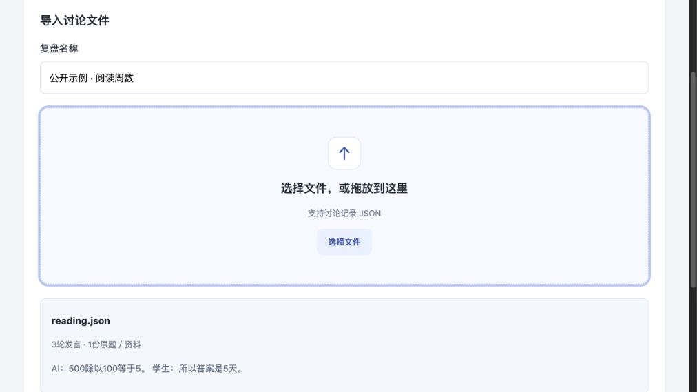

# 课堂讨论复盘 · Classroom Discussion Review

教学平台中的一个课后处理模块：读取原题和完整讨论，追踪答案与理由的修正，找出最后仍未解决的问题，整理补充讲解。

它不提供课程管理或新的课堂聊天。网页入口用于独立运行这个模块，也可以通过HTTP接口接入已有平台。

## 能做什么

- 接收一段完整讨论和原题，先独立核对原题，再查看讨论结论。
- 分开核查答案、理由、数量对象和适用条件；已经修正的旧观点不重复纠错。
- 验证算式和原文引用；确认问题后生成讲解，再检查讲解里的推导与依据。
- 保存处理结果，支持命名、历史搜索、重命名和下载讲解。
- 可选导入课程资料并按课程、版本检索。资料检索是辅助能力，不宣称提升准确率。



界面截图为导入项目自行构造的示例后、尚未执行模型分析的状态。

## 快速开始

需要Python 3.10或更新版本及带FTS5的SQLite；服务使用Python标准库，无需额外Python依赖。当前只绑定本机 `127.0.0.1`。

```sh
cp .env.example .env
```

编辑 `.env`，填写支持Chat Completions与工具调用的API服务：

```dotenv
CHEMTUTOR_BASE_URL=https://你的API服务/v1
CHEMTUTOR_MODEL=你的模型名称
CHEMTUTOR_API_KEY=你的密钥
```

地址填写API根路径，不附加 `/chat/completions`。然后启动：

```sh
sh scripts/start.sh --provider-env .env
```

打开 <http://127.0.0.1:8875/>。未配置API也可以启动和查看界面，但不能运行模型处理。项目不会自动更换模型或服务商。

本公开版本使用通用API连接，不依赖开发者的Codex登录、MemoryOS安装目录或外部硬盘路径。各服务商的兼容性需在自己的配置下验证。

## 使用

1. 填写复盘名称，选择或拖入JSON文件。未填写名称时使用文件名。
2. 确认预览，点击“开始处理”。模型请求会发送给你配置的服务。
3. 阅读结果和补充讲解，下载需要的内容。未通过内部核验的讲解不会显示为可用输出。
4. 从“历史复盘”重新打开、搜索或重命名记录；“设置”查看当前连接与用量限制。

样本、手动编辑、资料检索放在高级选项中。`examples/`提供两份**自行构造的输入**，不包含伪装成真实运行的模型结果。

### 输入格式

```json
{
  "title": "阅读周数讨论",
  "task_type": "math_word_problem",
  "messages": [
    {"id": "T1", "role": "student", "text": "每周读100页，500页需要5天。"},
    {"id": "T2", "role": "assistant", "text": "500除以100等于5。"},
    {"id": "T3", "role": "student", "text": "所以答案是5天。"}
  ],
  "materials": [
    {"id": "R1", "title": "原题", "text": "每周读100页，一本书500页，需要多少周读完？"}
  ]
}
```

角色支持 `student`、`teacher`、`assistant`。发言与资料各自的编号必须唯一。`task_type`是可选字段，当前指定类型只支持 `math_word_problem`。

一份输入最多80条发言、30份资料，单条文本最多16,000字符；HTTP请求总JSON上限300,000字节。界面可解析不超过2MB的文件，但模型提交仍受HTTP上限限制。普通TXT、PDF、Word和批量JSONL尚未提供自动转换。

### 可选课程资料

自行准备有权使用的来源，不需要修改模型或给出参考答案：

```json
[
  {"id": "course-rule-1", "title": "课程约定", "text": "在此填写课程原文。", "url": "https://你的资料出处"}
]
```

```sh
python3 scripts/import_knowledge.py sources.json --course your-course --version 1
```

在高级选项中显式启用对应课程与版本。界面默认不检索资料。

## 接入已有平台

- `POST /api/workbench-run`：提交上述输入，返回运行编号；在后台完成分析。
- `GET /api/workbench-job?id=…`：读取状态、结果、资料引用及讲解。
- `GET /api/workbench-history`：分页读取历史元数据，支持 `q`、`offset`、`limit`。
- `POST /api/workbench-rename`：提交 `{"id":"运行编号","name":"新名称"}`。
- `GET /api/settings`：读取当前连接信息，不返回API Key。

运行记录位于 `var/workbench/`，显示名称单独保存。它们和本机配置均被Git忽略。当前接口服务用于本机使用；账号体系、课堂采集和平台部署由所在平台承担。

## 实现与验证

```text
原题／资料 → 独立依据 → 最终答案与理由 → 对照核查 → 讲解生成与核验
```

流程由代码编排，模型在阶段内解释、提取和生成；工具执行计算、资料读取和引用校验。没有让模型自由执行生成的代码。

```sh
python3 -m unittest discover -s tests -v
```

测试使用模拟模型或模拟网络，不消耗实际API用量。这些检查验证流程与约束，不能当作教学准确率。

默认一个服务进程最多40次请求、90,000个已报告token的软阈值，单个复盘最多16次请求。通过 `.env`中的 `CHEMTUTOR_MAX_REQUESTS`、`CHEMTUTOR_MAX_TOTAL_TOKENS`调整进程限制；重启后重新计数。额度不足或格式核验失败可能留下未完成记录。

## 范围与边界

这是课后讨论复盘模块，不是完整教学平台。公开版本没有真实学生数据，也没有生产课堂部署或学习效果结论；模型可能误判语义条件，讲解复核也不保证完全正确。

开发阶段曾使用MathDial（真人教师／模拟学生）以及Wikibooks和JWST官方资料检查流程。公开仓库不附带这些讨论、教材全文、参考答案或私人模型日志，详情见[资料说明](docs/SOURCES.md)。已有小样本检查不能证明资料检索带来稳定纠错增益。

## License

代码与项目自行构造的示例采用[MIT](LICENSE)。外部课程资料与数据集仍按其各自授权使用。
